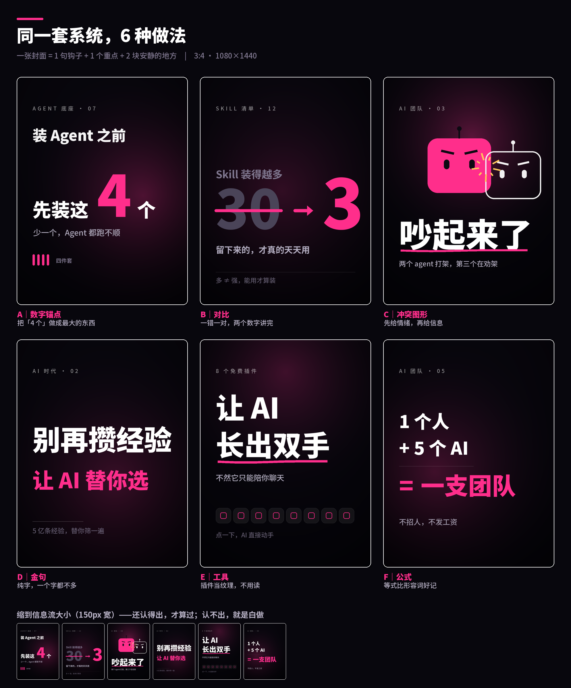
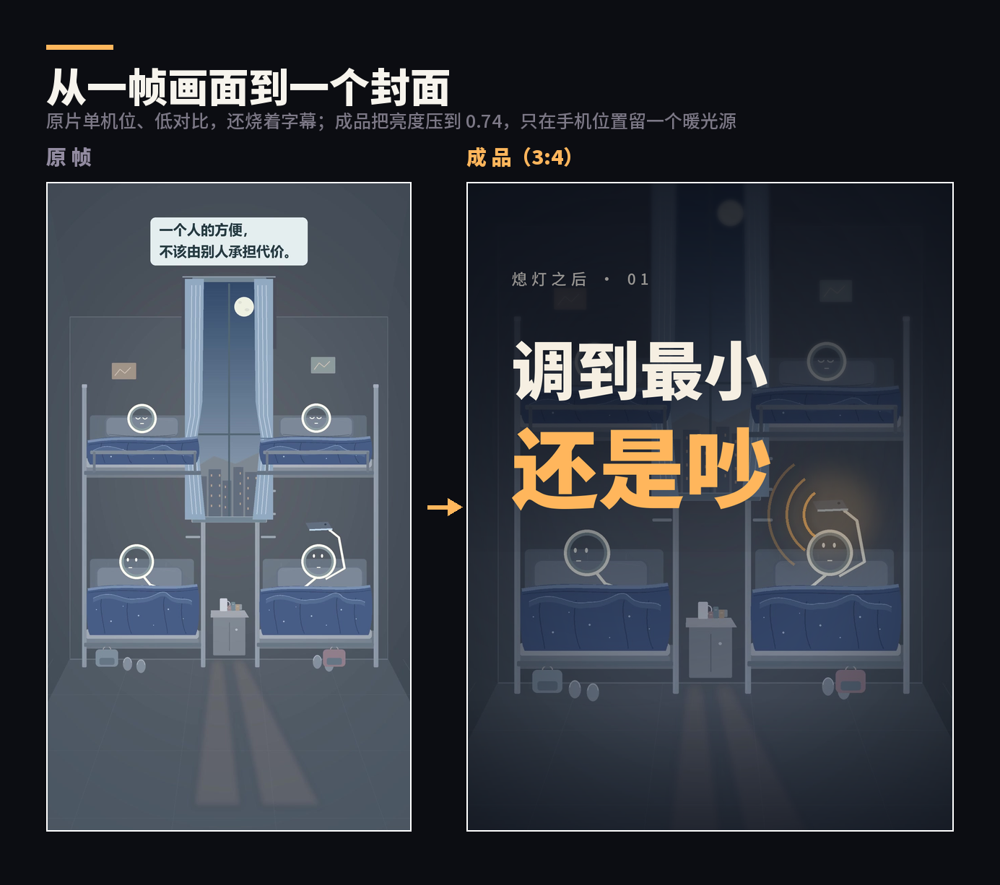
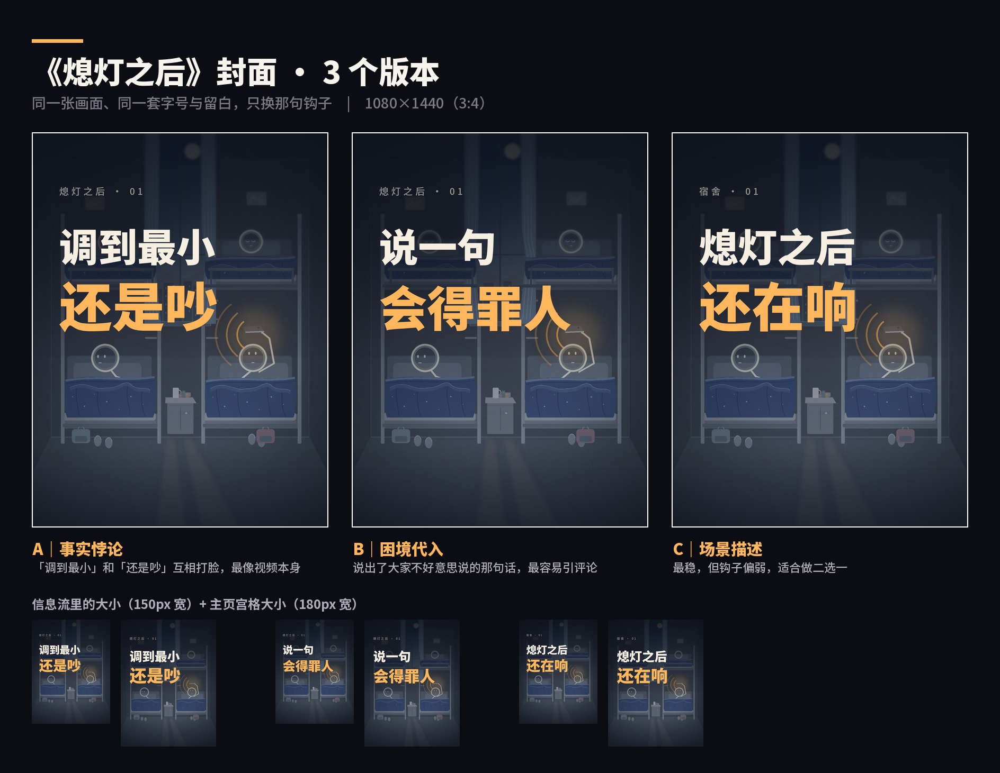

# 抖音封面方法论：从诊断到可复用的版式系统

> **一句话结论：封面真正要做的，是在一秒内交付「一个最具体的事实」，而不仅仅是「把标题搬上去」。**
> 这篇是我用一套完整流程跑出来的：先诊断一个真实账号的 18 张封面，提炼出可执行的规则，
> 再拿一段 48 秒的宿舍情景动画做落地验证，输出 3:4 / 9:16 / 4:3 三种尺寸。


---

## 目录

| 文件 | 内容 |
|---|---|
| [`docs/diagnosis.md`](docs/diagnosis.md) | 诊断：为什么「重点不突出」——6 个病灶 + 每一条的现场证据 |
| [`docs/system.md`](docs/system.md) | 规则：三元素、三级字号、70-20-10 色彩预算、安全区、6 种做法 |
| [`docs/case-dorm.md`](docs/case-dorm.md) | 案例：《熄灯之后》从选帧到三种尺寸的完整做法（含参数） |
| [`scripts/`](scripts/) | 生成这些封面的 Python 脚本（Pillow，可直接跑） |

---

## 一、先看结论：这张封面到底差在哪

被诊断的是一个 AI 知识类账号，深紫黑底 + 荧光品红，风格统一、辨识度很高——**配色是它唯一真正立住的东西**。

问题不在「不好看」，在**什么都舍不得删**：

| # | 病灶 | 现场证据 |
|---|---|---|
| 1 | **高亮变成花纹** | 每张 2–4 个品红色块，覆盖标题 60% 以上。高亮一旦到处都有，就等于没有 |
| 2 | **信息块严重超载** | 「装完 agent 接上 GitHub」那期：12 个信息块、8 级字号。层级超过 3 层，第 4 层就没人看 |
| 3 | **字号阶梯断档** | 主标和副标只差 1.4–1.6 倍，还同色同字重，视线滑过去没有停顿点 |
| 4 | **人脸和字抢同一块地** | 人像占 40–50%，浮窗贴着人脸；两者亮度、饱和度一样，等于两个主角 |
| 5 | **四角全是杂物** | 左上栏目、右上分类、左下点赞、右下水印——而点赞和标题平台本来就会显示（他甚至把点赞数烧进了封面图） |
| 6 | **版式一模一样** | 十几期同一个模子，刷到第 3 张大脑就归类成「重复内容」跳过 |

再往下还有一层更根本的：**选题同质化**。十几期里 5 期都在讲「AI 团队 / AI 员工」，选题一样，
封面只能靠换词区分，越换越挤。**封面改不动的时候，先改选题。**

### 一个值得记住的对照

| 点赞 | 标题 | 特征 |
|---:|---|---|
| 1.8 万 | 我的 AI 员工吵起来了，还有 1 个在劝架 | 钩子极具体，有画面、有冲突 |
| 177 | 拉开差距的 3 个要素 | 纯抽象价值主张 |

所以顺序是：**先写对那句话，再排好看**。排版能保证「看得清」，保证不了「想点」。

---

## 二、五条能直接执行的规则

1. **一封面 = 1 句话 + 1 个重点 + 2 块安静区域**
   重点只能是「数字 / 图形 / 脸」三选一，出现两个就等于没有重点。
2. **字号只留 3 级，比例 1 : 0.3 : 0.2**
   主标、副标、标识。字重只用两种，去掉描边。主副标至少差 2.5 倍。
3. **色彩预算 70 / 20 / 10**
   70% 暗部 + 20% 中性白 + 10% 一个强调色。强调色在一张封面上只出现一次。
4. **固定安全区**
   左边距 100（1080 宽画布）；顶部 200 只放一句话；底部 200 留空——信息流里平台字幕就在那儿。
5. **150px 检验**
   缩到 150px 宽还认得出，才算过。认不出就是白做。

---

## 三、六种做法（同一套系统）



| 模板 | 用于 | 关键动作 |
|---|---|---|
| A 数字锚点 | 有清单、有数量 | 把「4 个」做成画面里最大的东西，清单一律删掉 |
| B 对比 | 有误区 / 正解 | 一错一对，两个数字讲完一个观点 |
| C 冲突图形 | 有观点、有情绪 | 先给情绪，再给信息；图形替代人像 |
| D 金句 | 纯观点 | 一个字都不多余，靠字号和留白撑住 |
| E 工具 | 插件、软件 | 图标只当纹理，不给用户读的机会 |
| F 公式 | 有结构关系 | `1 个人 + 5 个 AI = 一支团队`，等式比形容词好记 |

模板要跟选题类型绑定、轮换使用——主页看起来才不会像壁纸。

---

## 四、案例：把上面的规则用在真人素材上

素材是 48 秒的宿舍情景动画（1080×1920 / 24fps），全片**同一个固定机位**，低对比度的浅灰蓝，画面很温柔。

直接截图当封面会死得很安静：信息流里就是一团灰蓝。



做法只有四步：

1. **压成夜景**——整体亮度 ×0.74，顶部渐变到黑。给文字让出一条通道，也更符合「熄灯后」。
2. **只留一个暖光源**——在手机位置加暖光和三圈声波。全片唯一的饱和色是暖橙 `#FFB65C`，视线只有一个落点。
3. **三级字号**——栏目 34 / 事实行 142 / 结论行 192，字色用取自片中对白气泡的奶油白 `#F6EFE2`。
4. **一个钩子**——把片子的转折点压成七个字：**调到最小，还是吵**。

| 尺寸 | 文件 | 用途 |
|---|---|---|
| 3:4 · 1080×1440 | [case-3x4](images/case-3x4.png) | 抖音主页宫格封面 |
| 9:16 · 1080×1920 | [case-9x16](images/case-9x16.png) | 视频首帧 / 信息流预览 |
| 4:3 · 1440×1080 | [case-4x3](images/case-4x3.png) | 横版投放、图文 |

同一套版式换三句钩子，就能做 A-B 测试：



### 横版为什么要重排，不能直接裁

4:3 从 1080×1920 里只能取出 810 高的横带。试过三种放字位置，结论是**都会压住其中一个角色**——
而这两个角色（一个睡不着、一个在玩手机）正是整个故事。谁被挡住，画面就失去意义。

所以横版改成**上下分带**：上方 372px 黑带放一整句，下方 708px 保住两张床和两个角色。
竖版是「先看字，再看画面」，横版是「先看出事的两个人，再读那句话」。

> 完整参数（裁切坐标、渐变位置、声波半径）见 [`docs/case-dorm.md`](docs/case-dorm.md)。

---

## 五、复用清单（发之前过一遍）

- [ ] 缩到 150px，还认得出在讲什么吗？
- [ ] 画面里有几个「最亮的东西」？超过一个就是没重点
- [ ] 主标和副标的字号差够 2.5 倍吗？
- [ ] 四角还剩几个元素？只留一个（期号），其他交给平台
- [ ] 底部 200px 是不是留空的？
- [ ] 强调色出现了几次？超过一次就减掉
- [ ] 这句话，是我自己也会停下来看的吗？

---

## 六、脚本

`scripts/` 下四个脚本，依赖只有 Pillow + numpy：

| 脚本 | 产出 |
|---|---|
| `template_system.py` | 六种做法的示意封面 + 前后对比图 |
| `dorm_cover.py` | 案例的 3:4 / 9:16 三个文案版本 |
| `dorm_cover_43.py` | 案例的 4:3 横版（分带布局） |
| `preview_sheet.py` | 三版对比 + 信息流缩略图检验 |

```bash
pip install pillow numpy
python scripts/dorm_cover.py        # 输出到 ./out/
```

字体默认用 `C:\Windows\Fonts\NotoSansSC-VF.ttf`，其他系统用环境变量指定：

```bash
export COVER_FONT=/path/to/NotoSansSC-VF.ttf
```

---

## 版权与说明

- `assets/before-github-cover.png` 与 `images/diagnosis-before-after.png` 中包含另一位创作者的封面截图，
  **仅用于设计点评与评论引用**，版权归原作者。
- `assets/source-frame.jpg` 是案例视频的单帧截图，用于复现脚本。
- 其余封面、文字、代码为原创。

---

*整理自一次真实的设计复盘：诊断 → 规则 → 落地 → 对比。如果你也在做知识类内容，这几条应该能直接用。*
