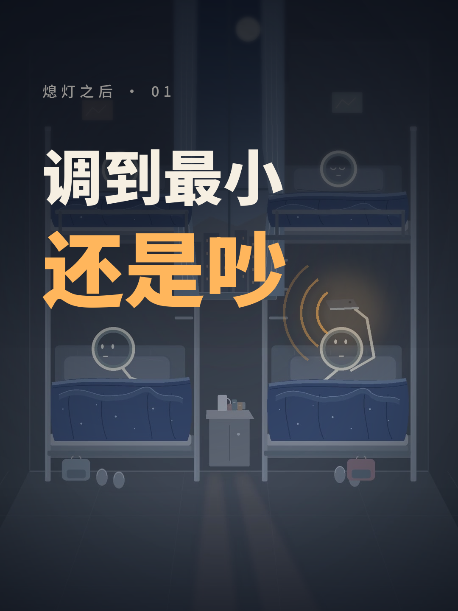
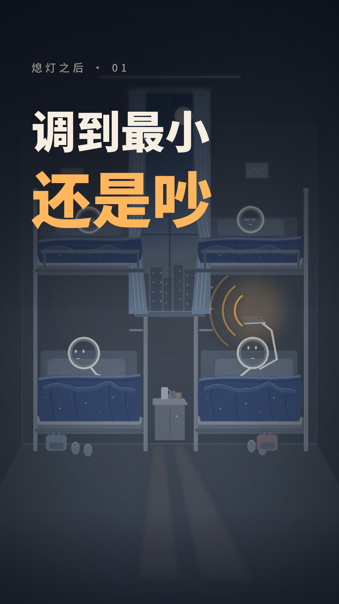
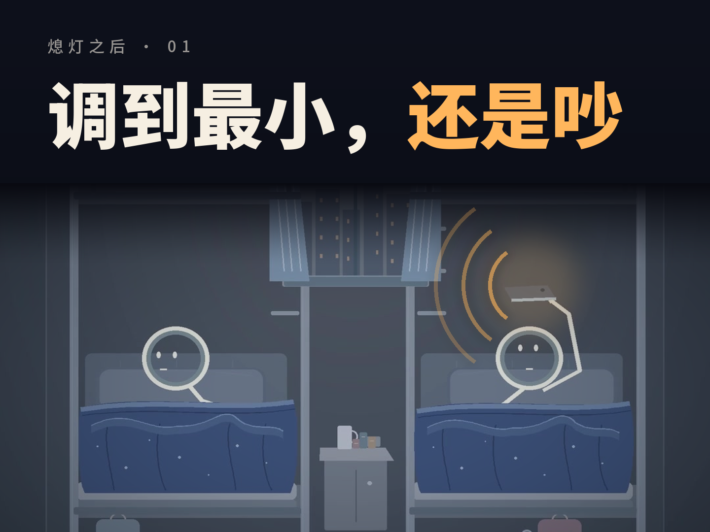
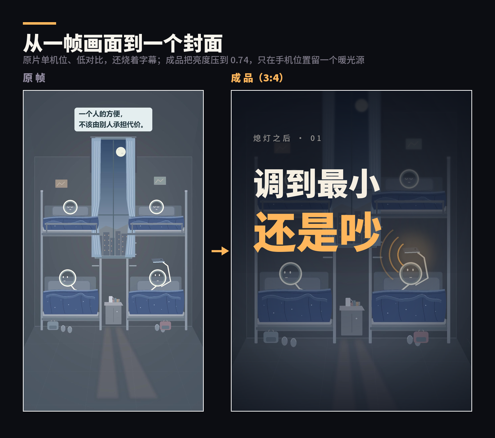
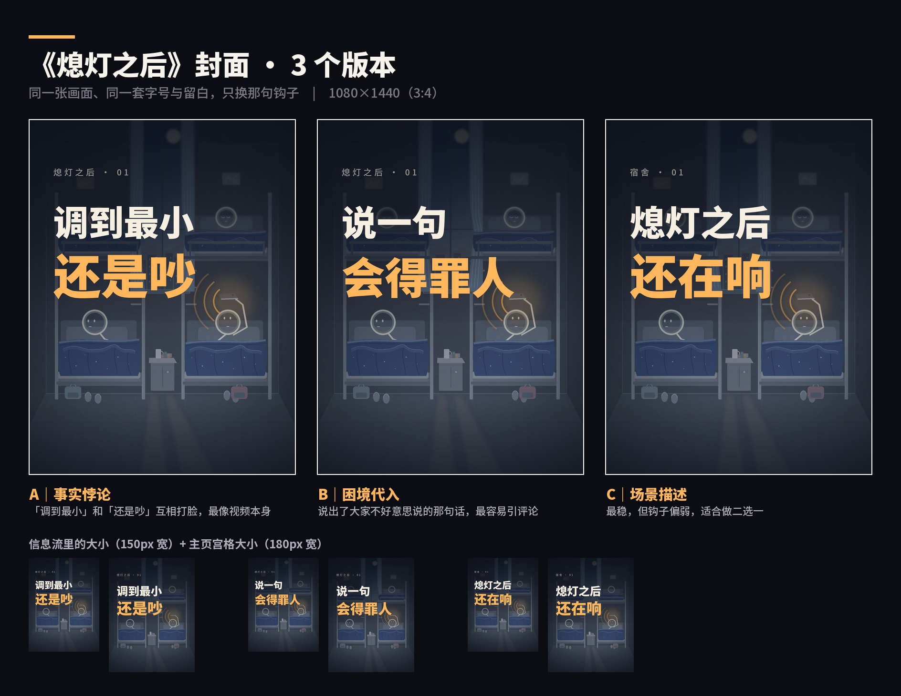

# 案例：《熄灯之后》——从一帧画面到三种尺寸

> 素材：`dorm_stick_starry_narration.mp4`，48 秒，1080×1920，24fps。
> 内容是宿舍情景动画：熄灯后有人手机外放，另一个人睡不着。
> 交付：3:4 主页封面 + 9:16 首帧 + 4:3 横版。

| 尺寸 | 成品 |
|---|---|
| 3:4 · 1080×1440 |  |
| 9:16 · 1080×1920 |  |
| 4:3 · 1440×1080 |  |

### 原帧 vs 成品



左边是视频 43.0 秒的原帧：单机位、低对比，还烧着字幕。
右边是成品：字幕被裁掉，画面压暗，手机位置长出一个暖光源，字落在被压黑的顶部。

---

## 1. 素材诊断：为什么不能直接截图

三个事实决定了做法：

1. **单机位、全片一个镜头**。没有特写、没有运镜，画面信息是平铺的。
2. **低对比度、浅灰蓝**。这是「温柔」的美术选择，但在信息流里等于隐形——
   缩到 150px，它就是一块雾蒙蒙的蓝色。
3. **竖向 9:16，但真正有戏的只有中段**。上方是空墙和窗，下方是地板。

所以封面必须做一件事：**给它造一个「最亮的东西」**。

---

## 2. 四步改造

### 第 1 步：选帧

关键帧候选：0.6s（字幕在右上）、18s（字幕居中）、43s（字幕在顶部）、47s。

选 **43.0s**：字幕在最顶部，裁掉即可；此时右边角色举着手机、左边角色睁着眼睛，故事最完整。

裁切：`(0, 300, 1080, 1740)` → 1080×1440（3:4）。

### 第 2 步：压成夜景

| 参数 | 值 | 作用 |
|---|---|---|
| 整体亮度 | × 0.74 | 从「傍晚蓝」拉到「熄灯后」 |
| 色温偏移 | +RGB(10, 18, 38)/255 | 暗部偏冷，和暖光形成冷暖对比 |
| 顶部渐变 | 0 → 820px 内 alpha 0.74 → 0.04 | 给文字让出一条干净的通道 |
| 底部渐变 | 最后 300px 内 alpha 0 → 0.55 | 把画面「坐」进黑暗里 |
| 顶部虚化 | 0 → 46% 高度，高斯 4.5px | 视线上半部分失焦，主体更突出 |

> 注意：这里压暗不是为了「气氛」，是为了**制造可读的文字通道**。原片最亮的是窗户，
> 不压暗，白字上去就是糊的。

### 第 3 步：造一个唯一的暖光源

原片里手机是个深色板子，没有发光。但「外放」这个动作需要被看见，所以：

- 手机中心 `(807, 1005)` 加暖橙 `#FFB65C` 径向光斑（半径 118，alpha 46，高斯 34）
- 三圈声波弧线，半径 62 / 100 / 140，开口朝左（打向睡着的人），alpha 155 / 118 / 70

为什么用「声波」而不是「屏幕光」：画面里我们看到的是手机背面，画屏幕光在物理上说不通；
而声波弧线既符合语义（外放的是声音），又给画面提供了唯一的饱和色。

**这一步是整个改造的核心**：全图只有一个高饱和点，视线就只有一个落点。

### 第 4 步：三级字号

| 层级 | 字号 | 颜色 | 内容 |
|---|---:|---|---|
| 标识 | 34 | 奶油白 60% | 熄灯之后 · 01 |
| 事实行 | 142 | 奶油白 100% | 调到最小 |
| 结论行 | 192 | 暖橙 100% | 还是吵 |

- 奶油白 `#F6EFE2` 取自片中的对白气泡米色——**文字色和画面同源**
- 暖橙只给结论行，和手机光源同色——**语义分色：亮着的部分 = 声音**
- 两行字号差 1.35 倍，但因为第二行只有 3 个字、颜色高饱和，视觉权重天然更大

---

## 3. 三个文案版本

同一套版式，只换那句话：



| 版本 | 文案 | 逻辑 | 适用 |
|---|---|---|---|
| **A** | 调到最小，**还是吵** | 事实悖论：两句互相打脸 | 主用（最像视频本身） |
| B | 说一句，**会得罪人** | 困境代入：说出大家没说出口的话 | 引评论 / 做 A-B 测试 |
| C | 熄灯之后，**还在响** | 场景描述 | 最稳，钩子偏弱 |

推荐 A 做主页封面，B 留作第二条测试。C 区分度不够，可排除。

> 「调到最小，还是吵」的来源是片子 15–25 秒的两句台词：
> 「声音已经调到最小了。」「可是，声音还是很明显……」——**把转折点本身当封面**，
> 比总结一个道理更有力。

---

## 4. 横版 4:3 为什么要重排

4:3 = 1440×1080，从 1080×1920 里只能取出 **810 高的横带**。试了三种放字位置：

| 方案 | 结果 |
|---|---|
| 字放左上 | 压住左边「睡不着」那个角色 |
| 字放左下 | 压住床和被子，字在画面中间悬空 |
| 字放中间 | 两个角色各被切一半 |

**结论：直接裁 + 叠字这条路走不通。** 那个房间是左右对称、没有空象限的，任何位置都会压住人。

于是改成**上下分带**：

| 参数 | 值 |
|---|---|
| 标题带高度 | 372px（约 34%） |
| 画面带 | 708px，裁 `(0, 840, 1080, 1402)` |
| 接缝 | 170px 渐变，缓动 `^1.5` |
| 标题字号 | 146，一行排完「调到最小，还是吵」 |

竖版是「字在上、画面在下」的竖向顺序；横版沿用同构——**上带讲故事，下带看人**。
代价是丢掉窗户和月亮，换来两个角色都完整。

> 试过 330px 的柔和接缝，反而把窗户的城市剪影糊掉了，退回 170px。

---

## 5. 可复用参数表

```yaml
画布:
  3:4  : 1080 x 1440
  9:16 : 1080 x 1920
  4:3  : 1440 x 1080

安全区:
  左/右: 100
  顶   : 200
  底   : 200   # 留给平台字幕

字号(1080 宽基准):
  标识: 34   Medium  60% 白
  事实: 142  Black   100% 白
  结论: 192  Black   强调色

调色:
  亮度乘数: 0.74
  顶部渐变: 0 → 820px, alpha 0.74 → 0.04
  底部渐变: 最后 300px, alpha 0 → 0.55
  顶部虚化: 46% 高, 高斯 4.5

暖光源:
  中心: (807, 1005)
  光斑: 半径 118, alpha 46, 高斯 34
  声波: 半径 62/100/140, alpha 155/118/70, 开口 126°–234°
```

---

## 6. 复盘：这一步做对了什么

1. **没有改画面，只改光的分布**。美术风格保留，但视线被重新引导。
2. **强调色从素材里长出来**，不是硬加一个品牌色。
3. **文案取自台词，不是总结**。观众认的是那一秒，不是那句道理。
4. **每个尺寸重新想，不缩放**。4:3 的重排不是妥协，是另一种构图。
