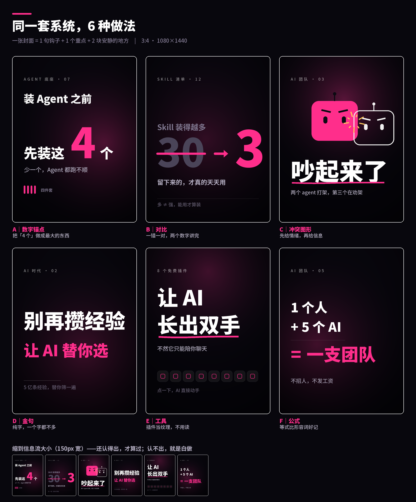

# 版式系统：从规则到可复用模板

> 这是把诊断结论翻译成「能照着做」的一套参数。所有数值以 **1080 宽画布**为基准，
> 换尺寸按比例缩放即可（脚本里用 `s = width / 1080`）。

---

## 1. 三元素法则

一张封面只允许出现三类元素，每类最多一个：

| 元素 | 说明 | 例 |
|---|---|---|
| **一句话** | 主标，≤10 字，最好 7–8 字 | 调到最小，还是吵 |
| **一个重点** | 数字 / 图形 / 脸，**三选一** | 巨大的「4」 |
| **一块呼吸区** | 至少占 25% 面积的暗部或留白 | 顶部黑带 |

第三类是最容易忽略的：**留白也是内容**，它决定了眼睛愿不愿意停下来。

---

## 2. 字号阶梯

只留三级，比例约 **1 : 0.3 : 0.2**。

| 层级 | 用途 | 1080 宽画布字号 | 例 |
|---|---|---:|---|
| 主标 | 那句钩子 | 140–200 | 调到最小，还是吵 |
| 副标 | 补一句事实 | 44–56 | 从「能聊天」到「能干活」 |
| 标识 | 栏目 / 期号 | 32–34 | 熄灯之后 · 01 |

规则：

- 主标和副标至少差 **2.5 倍**，理想 3 倍以上
- 字重只用两种（Black + Medium），不要第三种
- 不要描边、不要投影、不要渐变字
- 大字号字距压到 -1% ~ -2%，行高 1.0–1.05

---

## 3. 色彩预算

**70% 暗部 + 20% 中性白 + 10% 强调色**。

| 角色 | 占比 | 做法 |
|---|---:|---|
| 暗部 | 70% | 单色深底 + 一层很淡的光晕，不铺满渐变 |
| 中性白 | 20% | 文字主体，用暖白（如 `#F6EFE2`）比纯白更有质感 |
| 强调色 | 10% | 一个高饱和色，全图只出现一次 |

强调色的选择最好**从素材里取**，不要外挂：

- AI 工具类账号：荧光品红 `#FF2E8B`（识别色）
- 温情 / 生活类内容：取自画面里的光，如手机暖光 `#FFB65C`

这比「随便挑个喜欢的颜色」高一个档次——因为强调色和画面同源，观众会默认它们是一体的。

---

## 4. 安全区

以 1080×1440 为例：

```
┌──────────────────────────┐
│  ↑ 顶部 200：只放一句话    │
│  ←                      │
│ 100                      │
│  ←      主体区域          │
│                          │
│  ↓ 底部 200：留给平台      │
└──────────────────────────┘
```

- **左 100 / 右 100**：所有文字左对齐在 100 这根线上
- **顶 200**：栏目和主标起手的位置
- **底 200**：留空。信息流里平台的标题、作者、按钮就压在那儿

留空不是浪费——**被遮住的才算浪费**。

---

## 5. 六种模板



### A 数字锚点

用于有清单、有数量的选题。

```
AGENT 底座 · 07          ← 标识 34
装 Agent 之前            ← 副标 92
先装这 [4] 个            ← 主标 118 + 数字 360
少一个，Agent 都跑不顺     ← 支撑句 50
▮▮▮▮ 四件套              ← 装饰刻度条
```

关键：**把数字做到画面里最大的东西**，原来的清单全部删掉。

### B 对比

用于「有误区 / 有正解」的选题。

```
SKILL 清单 · 12
Skill 装得越多
[30]  →  [3]            ← 灰 + 划线 → 品红
留下来的，才真的天天用
```

关键：左边灰、划线；右边满饱和。一个箭头讲完全部逻辑。

### C 冲突图形

用于有情绪、有观点的选题。

- 图形替代人像（两个机器头对撞 + 火花）
- 主标 200+，配一根手绘感下划线
- 副标只做补充，不超过一行

### D 金句

纯文字，一个字都不多余。

- 主标铺满 880 宽（按字数自动 fit）
- 第二行用强调色
- 底部一根短横线 + 一行极淡的小字

### E 工具

用于插件、软件清单。

- 图标缩成一条等距小方块，**只当纹理，不给用户读的机会**
- 主标讲「结果」而不是「清单」（让 AI 长出双手，而不是「8 个插件推荐」）

### F 公式

用于有结构关系的选题。

```
1 个人
+ 5 个 AI
─────────
= 一支团队
```

等号那行用强调色放大 1.3 倍。等式比形容词好记。

---

## 6. 模板轮换

不要每期都换模板，也不要一直用同一个。建议按选题类型绑定：

| 选题类型 | 模板 |
|---|---|
| 清单 / 数量 | A 数字锚点 |
| 纠错 / 反常识 | B 对比 |
| 观点 / 情绪 | C 冲突图形 · D 金句 |
| 工具 / 资源 | E 工具 |
| 结构 / 方法论 | F 公式 |

主页宫格里 A、B、C 交替出现，密度才有呼吸。

---

## 7. 检验方法

发之前跑三个测试：

1. **150px 测试**：缩到 150px 宽还认得出，才算过。
2. **眯眼测试**：眯起眼看，还能分出主次吗？分不出就是层级不够。
3. **黑白测试**：去掉颜色，画面还有结构吗？如果只剩一片灰，说明全靠颜色在撑。

---

## 8. 反面清单

- ❌ 一句话里 3 个色块
- ❌ 主标、副标同字号
- ❌ 四点加框、双线描边、发光字
- ❌ 把点赞数、标题条、水印烧进图片
- ❌ 04–08 这种清单小字（信息流里只有 6px）
- ❌ 每张都长一样
